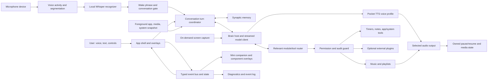

# Project Iris: end goal and acceptance contract

This is the product-level definition of “ready.” It complements the design references,
architecture notes, roadmap, and troubleshooting guide. A feature is not complete merely
because a screen or class exists: its normal path, failure path, recovery path, and resource
cost must all be understandable and verified.

The goal is a dependable, real-time local companion for this machine, with room to grow through
maintainable modules and memory. “Perfect” means polished against this contract, with no known
release-blocking defects and with the important paths exercised on the target PC. No honest
engineering process can promise that software will contain literally zero bugs forever; the
promise is to keep testing, fixing, measuring, and documenting until the acceptance criteria
below are met, and to fix regressions found afterward.

## 1. Product principles

1. **Works before spectacle.** A control changes real state, a status describes real state, and
   a failure gives the user a useful next step. No fake progress, fake listening, or success
   message for a failed action.
2. **Fast and considerate of this PC.** Keep the RTX 3050's 8 GB VRAM available for the brain
   and other foreground work. Keep voice recognition and synthesis on CPU. Bound CPU threads,
   avoid full-disk scans and frequent child processes, and measure the idle and active costs.
3. **One Iris across components.** Persona, voice profile, conversation state, memory, current
   activity, permissions, music state, and overlays share clear contracts. A component reports
   what it did so the other components can react without guessing.
4. **Permission follows impact.** Read-only discovery has a clear scope; file writes, app
   launches, and system changes request the level of confirmation they need. Refusal, timeout,
   cancellation, and retry are normal outcomes.
5. **Local by default and explicit about data.** Microphone audio is not saved or sent away by
   default. Screen capture happens on request or under a visible opt-in mode. No secret tokens,
   private machine data, model weights, or build outputs go into the repository.
6. **Composable, not a pile of switches.** Each module has an owner, lifecycle, capability
   description, permission policy, resource budget, visible state, and failure contract.
   Optional modules can be disabled without disabling Iris's core conversation.
7. **Useful uncertainty.** Iris asks one short question when choosing wrong would matter,
   explains what she could not verify, and never claims AGI or human understanding as a fact.

## 2. Target hardware and budgets

Primary target: Ryzen 5 5600X (6 cores / 12 threads), RTX 3050 (8 GB VRAM), 16 GB system RAM,
and limited free SSD space. Re-measure if the hardware changes.

| Area | Acceptance target |
|---|---|
| VRAM | No speech, music, wake-word, or memory helper allocates VRAM. The brain reports its actual allocation; Gaming/Sleep releases Iris-owned brain VRAM. The app keeps a configurable reserve for Windows and other foreground applications. |
| ASR CPU | Default to at most two Whisper threads, BelowNormal priority where supported, serial recognition, no transcription while ears are closed, and no recognizer model resident in Sleep or default Gaming Mode. Report actual settings and active state. |
| TTS CPU | Pocket TTS remains the default CPU path, capped at two threads and BelowNormal priority. Keep one runtime/model family; no extra runtime is adopted without measured quality, consistency, latency, RAM, CPU, and disk benefits. |
| Responsiveness | Warm short TTS replies should start promptly; measure cold start and warm P50/P95 separately. ASR should process a normal short command faster than its spoken duration on the target CPU, or clearly report that it did not. Never hide a long scan or model startup behind “Done.” |
| Idle cost | Measure CPU, RAM, disk activity, child processes, microphone state, and VRAM while Awake, Resting, Gaming, and Sleeping. Set numerical release budgets from repeatable measurements, not estimates. |
| Storage | Setup is repeatable and resumable, downloads only selected components, verifies size/hash where available, explains license acceptance, and never duplicates model caches or runtimes. Show where data lives and how to reclaim generated caches safely. |

## 3. How the components connect

The event/state contract is the spine: a wake signal opens the voice turn, pauses media only
when configured, shows Iris's attention state, and routes the transcript to the same
conversation coordinator as typed chat. The coordinator selects memory and relevant tools,
obtains permission where needed, executes one action at a time, checks the result, streams a
response, sends that response through the chosen stable voice profile, and updates the chat,
status orb, overlay, music controls, and event log. Cancellation, sleep, gaming, or device loss
must stop or suspend the owning work and visibly settle every dependent component.

## 4. Acceptance areas

### A. Setup, configuration, and recovery

- A clean install explains requirements, downloads only chosen components, validates model and
  runtime files, resumes partial downloads, verifies checksums when supplied, and reports
  license requirements before downloading gated weights.
- Setup and launch scripts are safe to rerun. Existing user model paths and settings survive
  upgrades. Settings migrations are atomic, versioned, recoverable, and tested from real old
  configurations.
- Missing/corrupt weights, unavailable drives, occupied ports, blocked microphone access,
  missing TTS runtime, and invalid endpoints produce a precise diagnosis and an actionable
  repair path. Text chat remains useful when audio is unavailable.
- Logs are bounded, readable, and redacted. They include component, operation, duration,
  outcome, and a correlation ID without saving raw microphone audio, secrets, or screen frames.
- Release package, setup documentation, license notices, and supported Windows/.NET versions
  agree with the code.

### B. Brain, conversation, and agentic work

- Streaming begins quickly, shows a visible thinking/streaming state, and can be stopped. No
  blank assistant bubble, dead Send button, stale spinner, or UI-thread freeze.
- Spoken and typed turns share context, cancellation, memory, tools, and honest result handling.
  A short “Hey Iris” gets a fast acknowledgement; a real command is routed to a relevant tool;
  multi-step work reads each result before choosing the next action.
- The model receives only tools relevant to the current request, within a tested tool budget.
  Tool schemas, names, routing descriptions, and examples are tested against the selected brain.
- Tool timeout, malformed arguments, missing capability, permission refusal, model disconnect,
  and partial success all return a truthful, concise response. Retry is bounded; no duplicate
  destructive action after an ambiguous timeout.
- Context trimming preserves system rules, recent user intent, pending confirmations, and
  useful memory. Long sessions do not grow context or memory without a configured bound.
- Model profiles state their actual vision/tool abilities, resource use, endpoint ownership,
  and limitations. An external endpoint is clearly distinguished from a local-only model.

### C. Hearing, calling Iris, and spoken conversation

- Device enumeration, Windows privacy denial, default and explicit device selection, unplug,
  reconnect, mute, silent input, and no-microphone startup are recoverable. “Mic open” is shown
  only while the native capture handle is open.
- The explicit mic test reports both whether Windows opened the selected device and whether it
  received signal. It never submits its samples to Whisper or stores them.
- Voice activity handles quiet speech, fan noise, keyboard clicks, a TV in the room, pauses,
  short calls, long utterances, and speech while Iris is talking. Thresholds have safe defaults
  and are explainable. Consider a small VAD model only if target-machine measurements justify
  its extra dependency and RAM/disk cost.
- “Hey Iris,” name-only calls, punctuation, configured greetings, common ASR misspellings,
  direct commands, and follow-up turns have a documented and tested wake policy. The user can
  choose push-to-talk/open conversation or wake-phrase mode. A real always-on keyword spotter
  is a separate opt-in feature; speech-to-text must not be described as one.
- Whisper loads only when needed, stays serial, observes the thread cap, and unloads in Sleep
  and default Gaming Mode. Empty, low-confidence, wrong-language, and missed transcripts do
  not trigger tools or fabricated replies.
- Barge-in stops Iris's speech promptly. The conversation window opens for a bounded period,
  then closes. The wake overlay reflects Listening, Thinking, Speaking, Error, and Idle truth.
- Hardware validation covers call-to-first-ack latency, end-of-speech latency, transcript
  accuracy, CPU peak/duration, false wake rate, and dropped speech at the real headset.

### D. Voice, profiles, and media behavior

- Pocket TTS is the single default engine: six profile IDs remain selectable, previews use the
  actual production pipeline, and the committed profile is the voice used by replies, reflex
  phrases, and any future body/lip-sync output. No hidden Windows voice fallback.
- Profile consistency is tested across repeated text, short/long replies, punctuation, sentence
  boundaries, restarts, cache rebuilds, and changing profiles. Voice changes are atomic; old
  cached clips never leak into the new profile. Accent, tone, and emotional range are advertised
  only when the actual samples demonstrate them.
- Measure cold start, warm first audio, total synthesis time, CPU/thread behavior, RAM, and file
  size on the target CPU. A quality claim requires the user to audition the samples; model
  identity alone is not a subjective sign-off.
- Missing runtime/model, process exit, timeout, invalid voice, invalid WAV, speaker hot-plug,
  volume zero, and playback cancellation are reported and recover without taking down chat.
- When configured, Iris pauses only the active media session she observed and records ownership
  of that pause. She resumes only media she paused; user-paused media is not resumed. Media
  state changes, focus changes, and timeouts are handled without pausing unrelated apps.
- Speech and music use the selected output device and user volume independently; TTS ducking
  is reversible and restores the prior level even on cancellation or error.

### E. Music, folders, playlists, and its overlay

- The user can guide Iris through folders one level at a time (“open Downloads; go into X; now
  Y”), hear concise progress, back up, choose a folder, and confirm adding it. She says what she
  found and asks whether to play; she never claims files were found until scanning finishes.
- Browsing is shallow and bounded; library indexing runs off the UI thread, has progress,
  cancellation, deduplication, permission/error handling, and hard bounds for folder count,
  time, and track count. It never scans an entire drive by default or follows symlinks into
  unexpected trees. Adding/removing a library root never moves or deletes source files.
- A disconnected, network, read-only, empty, huge, renamed, or permission-denied folder leaves
  the existing library usable. The user can retry or remove that root. Long scans remain
  cancellable and cannot create unbounded CPU, disk, or memory work.
- Search never plays an unrelated first result when nothing matches. Supported formats are
  listed accurately. Corrupt/unsupported files are skipped with a useful summary; output-device
  failure is not reported as successful playback.
- Play, pause, resume, stop, next, previous, shuffle, playlists, volume, and natural end-of-track
  behavior agree with one playback queue. Manual changes cannot race a stale track-ended callback
  into skipping or restarting music.
- The music player can be shown, minimized/hidden, repositioned, and restored independently of
  the mini Iris chat overlay. Hiding controls never stops playback. A new music overlay appears
  only when relevant, respects the saved layout, and can be dismissed by voice or button.
- Voice barge-in, TTS ducking, media pause/resume, music playback, and Windows media sessions do
  not fight each other. Scenarios cover Iris speaking over music, a game starting, headphones
  being unplugged, and a user manually pausing while Iris is working.

### F. Memory graph and learning

- Memory nodes have typed layers, relations, source/provenance, timestamps, confidence where
  supported, and a human-readable explanation. The user can inspect, search, correct, pin,
  export, and forget one exact item. A correction takes precedence without silently erasing
  history; secrets and transient small talk are not stored.
- Recall retrieves relevant memories without inventing facts. Similar wording, spelling
  variation, conflicts, stale preferences, no-match cases, and large graphs are exercised.
- Consolidation is bounded, reversible or auditable, and cannot silently destroy unique facts.
  It runs only when configured and idle; it never competes with a voice turn or game.
- SQLite writes are transactional; concurrent reads/writes, lock contention, crash recovery,
  backup/export, schema migration, and corrupted database behavior are tested. A graph can grow
  without causing unbounded prompt size or multi-second searches.
- Memory visualization remains legible at target sizes, supports keyboard/search/filter/inspect,
  communicates layer and link meaning without relying on color alone, and avoids fabricated demo
  nodes in the real view.

### G. Modules, tools, plugins, and permissions

- Every tool has one owner and stable ID; the What I Can Do screen reflects the live registry,
  enabled state, descriptions, permissions, and actual routing. Disabled modules never receive
  calls. Core time context is explained separately from an optional time tool/plugin.
- Built-in modules can be toggled immediately and persist across restart. A plugin being disabled
  stops routing immediately and stays disabled next launch. Enabling an external plugin is
  clearly labeled as a restart action. The sample `now.time` plugin stays optional.
- Plugin install is opt-in and inspected before use. Manifests are validated, namespaced,
  permission-scoped, timeout-bounded, and cannot shadow core tools or leak stdout/stderr. A
  disabled, removed, crashed, malicious, or hung plugin cannot block chat or silently run again.
- Permission cards name the exact action and target, show once/always/deny choices and timeout,
  keep focus usable, and settle the underlying task on every choice. “Always” is scoped narrowly
  and revocable. The audit trail records decisions without storing secrets.
- Timers, notes, app launch, machine status, and file search each have a clear module boundary,
  correct permission tier, cancellation, output, and Sleep/Gaming behavior. A timer continues or
  pauses only according to its documented lifecycle; duplicate reminders are not emitted.

### H. Perception, screen vision, and gaming

- Ambient state uses low-cost Windows APIs and a measured polling interval. It reports source,
  age, and unavailable state. It does not spawn expensive probes on every frame or while asleep.
- Screen capture is on-demand by default, visibly indicates live sharing, captures the intended
  display, bounds frame size/rate, avoids repeated unchanged frames, and stops immediately on
  stop/cancel/sleep. The model never claims to see a stale or uncaptured frame.
- Multi-monitor choice, HDR/scaling, exclusive-fullscreen limits, protected content, capture
  denial, and a changed screen are explained. Continuous streaming is opt-in and measured.
- Game detection has allow/exclude learning, no false transition loops, and visibly releases
  the brain when requested. Default Gaming Mode closes the mic and unloads Whisper; keeping ears
  on is an explicit choice with stated CPU cost. Returning from a game restores the intended
  mode without stale devices or duplicate processes.

### I. Sleep, lifecycle, and device/process failure

- Awake, Rest, Gaming, Sleep-to-tray, wake, shutdown, and crash recovery are serialized and
  idempotent. The mode state is published before teardown; repeated user actions cannot race or
  leave the app half awake.
- Sleep releases Iris-owned brain VRAM, closes microphone and TTS processes, stops timers and
  expensive polling, checkpoints memory, and leaves the documented tray affordance. Wake starts
  one process and restores state once. If the tray cannot be created, the app does not pretend to
  have slept.
- Each external process has arguments without shell injection, bounded startup/shutdown,
  concurrent stdout/stderr draining, cancellation, exit-code reporting, and cleanup of child
  processes. Repeated restarts do not orphan runtimes.
- The app stays useful with no mic, no speaker, no GPU, no model, no internet, no write access,
  a missing drive, or a crashed subsystem. One broken sense does not take down unrelated senses.

### J. UI, design fidelity, and feedback

- The supplied HTML, screenshots, and feedback are the **minimum floor**, not the final art
  direction or a ceiling. Preserve the intent and recognizable language, then improve the
  information hierarchy, interaction flow, feedback, iconography, spacing, accessibility, and
  motion wherever the result is clearer and more coherent. Add genuinely useful overlays or
  companion surfaces when they solve a real workflow; do not add decoration or noise just to
  make the app busier.
- Every implemented page is compared against the supplied references: Chat, Memory, Body,
  Persona/Voice, Settings, states/notices, and compact overlay. Departures may be improvements;
  they should be intentional, consistent with the product, and recorded in the design brief.
- All cards, labels, icons, buttons, toggles, dropdowns, dialogs, separators, tooltips, empty
  states, error states, loading states, and focus rings align to a shared spacing/type/color/icon
  system. No missing icons, inconsistent stroke weights, clipping, overflow, blank cards, dead
  buttons, mismatched labels, or unexplained status colors.
- The default mini overlay remains compact. Hover/click expands its bubble controls. Music,
  timer, permission, and other useful task surfaces appear in their own well-integrated overlays
  when needed; each can be hidden/minimized independently, and users can control visibility.
  Improve on the reference when that makes the component easier to use. Overlay position, edge
  snapping, monitor changes, z-order, focus, and persistence work.
- Chat handles long conversations, code/text, multiline input, scroll anchoring, cancellation,
  errors, and streaming at the 980×640 minimum. The sidebar, bottom status strip, and page content
  do not collide or stretch incorrectly.
- Validate 100%, 125%, 150%, and 200% display scaling, smallest supported window, maximized,
  resize, multiple monitors, keyboard-only navigation, screen-reader names, high contrast,
  reduced motion, and unavailable fonts/audio devices. No essential state depends on color or
  hover alone.
- Notices and feedback are calm, specific, dismissible, non-duplicated, and actionable. Long
  work says “searching/scanning/loading” with progress; completion only appears after the work
  is verified. Errors explain what failed and one next step.
- Animation is smooth but cheap; no render loop causes idle CPU/GPU drain. Reduce Motion is
  honored everywhere. Assets are repository-native where possible; no random icon packs.

### K. Security, privacy, and repository hygiene

- Repository ignores all local settings/data, secrets, models, voice clips, runtime binaries,
  temporary audition files, and build/publish outputs. Setup scripts contain no personal token.
- Network use is inventoried and opt-in/configured. Local endpoints are loopback-only unless
  the user explicitly configures otherwise. No raw voice, screen, or memory content is sent to a
  remote endpoint by default.
- File browsing and playback canonicalize paths, handle symlinks/reparse points, path traversal,
  Unicode names, removable drives, and permission boundaries. File actions do not overwrite or
  delete user data without an explicit, reviewed confirmation.
- Dependencies are pinned, licensed, updated with evidence, and minimized. A new model/runtime
  must justify its disk/RAM/CPU/GPU cost and have a rollback path.

## 5. Real-world release matrix

Before calling the companion ready, exercise each row on the target PC and keep measured results
with the build/release notes:

| Scenario | Required result |
|---|---|
| No mic; Windows mic permission denied; headset unplugged/reconnected | Clear offline state, no crash, text chat remains; correct device can be selected and recovered. |
| Quiet call, “Hey Iris,” wake-only call, direct command, false wake, room noise | Correct listen/wake/transcript route; false wakes do not run tools; latency and CPU recorded. |
| User interrupts TTS; TTS missing/crashed; headphones change mid-reply | Speech stops or recovers cleanly, error is truthful, no orphan process or stale audio. |
| User playing music/video when called | Only configured active media pauses; Iris listens; it resumes only if Iris owned the pause. |
| Browse a nested folder; deny permission; drive disappears; thousands of folders | Clear prompts and progress, bounded/cancellable scan, no drive-wide surprise or false “found.” |
| Search a missing track; play corrupt/unsupported file; shuffle; next/previous; playlist ends | No unrelated song, honest failure, predictable queue, stable player state. |
| Show/hide mini Iris, music overlay, timer and permission card | Components remain independently controllable, positioned, focused, and consistent with design. |
| Disable and enable built-in/time/plugin modules; plugin hangs or exits | Disabled tools cannot run; lifecycle state matches UI; plugin failure cannot wedge the assistant. |
| Brain missing/crashes; external endpoint unavailable; context full | App remains usable where possible, reports the precise missing capability, cancellation/recovery works. |
| Game starts/ends; Sleep and tray wake; repeated transitions | GPU release matches policy, default ears close in Gaming/Sleep, no race, duplicate or orphan process. |
| Memory correction, forget, conflict, restart during write, damaged settings/database | No silent data loss; migration/recovery is explained and auditable. |
| 100–200% scaling, narrow window, multi-monitor move, keyboard-only | No clipping, overlap, inaccessible control, stale overlay position, or dead keyboard path. |
| Long idle and active session | CPU/RAM/VRAM/disk/process budgets are measured; no unbounded logs, memory, audio segments, or recurring scans. |

## 6. Verification ownership

The assistant owns routine verification. Do not hand basic build, regression, setup, routing,
permission, or failure-path checks back to the user. Use automated tests, local fixtures,
mocked devices/endpoints, static inspection, and isolated integration runs first. Then use the
real application and available hardware for live checks when the machine has safe resource
headroom; record whether each result was simulated, model-backed, or physically observed. Load a
large brain model only for a check that genuinely needs it, confirm available headroom first,
and release it afterward. Never claim that a real microphone, audible timbre, or subjective
visual preference was physically verified when it was not. Ask the user for optional taste or
final acceptance feedback after the work is reviewable, not to do our debugging for us.

## 7. Definition of done

Project Iris is ready for the user's daily use only when all of these are true:

- The design-reference floor is met or intentionally improved upon, and additions strengthen
  the experience without harming clarity, consistency, performance, or user control.
- Core conversation, wake/listen, TTS, memory, music, modules, permissions, overlays, and
  sleep/game transitions pass their normal and failure scenarios on the target PC.
- A clean setup can reach that state from a fresh checkout without undocumented manual repair.
- Build and regression tests pass; integration and interaction checks are exercised as far as
  available tooling and hardware permit. Results distinguish real-device observation from
  simulation and headless compilation.
- Resource measurements satisfy agreed budgets during idle, voice use, brain use, and gaming.
- No known release-blocking bug remains. Known limitations, recovery steps, model licenses, and
  hardware tradeoffs are documented. The repository is clean, committed, and reproducible.
- The voice samples and UI/overlay decisions are ready for optional user acceptance review; we
  do not substitute user testing for engineering verification.

Until those conditions are met, status must say what is implemented, what is measured, what is
only code-reviewed, and what still needs live verification. A successful build is necessary,
but it is not proof that Iris is finished.
